<h3 align="center">QA Analyst | API Testing & Test Automation | SQL</h3>
<h1 align="center">Hola, soy Daniel!</h1>

### Sobre mí

Mi experiencia previa en desarrollo web me permite entender la arquitectura del software, depurar fallos desde el backend y diseñar estrategias de prueba con un enfoque analítico: Desde pruebas manuales documentadas hasta automatizaciónes E2E integradas a CI.

- 🎯 **Enfoque actual:** Automatización de pruebas E2E (Playwright + TypeScript), testing de APIs REST (Postman/Bruno), integridad de datos con SQL e integración continua (CI) con GitHub Actions  y entornos Docker.

- 📜 **Certificaciones:**
  - **ISTQB CTFL** — En preparación
  - **Aprende SQL** — midudev (2026)
  - **SQL Advanced** — HackerRank (2026)
  - **API Beginner Path** — Postman Academy (2026) 
  - **Scrum Fundamentals Certified (SFC™)** — SCRUMstudy (2023)

- 🎓 **Formación:** Tecnólogo en Análisis y Desarrollo de Software (SENA, 2025)

---

### Proyectos destacados

#### 🚀 [SenaWork — Plataforma Web / Bolsa de Empleo](https://github.com/Danywebx/SenaWork)
> Plataforma web en **Laravel + MySQL** como bolsa de empleos para trabajos informales, con una suite de **pruebas E2E automatizadas en Playwright + TypeScript** (Page Object Model, fixtures, CI en GitHub Actions) y documentación QA completa (plan de pruebas, matriz de casos y reporte de bugs).

#### 🔌 [Restful Booker API Suite — Testing & Automation](https://github.com/Danywebx/RestfulBookerAPI)
> Suite de automatización de pruebas de API REST con **Postman + JavaScript**, con encadenamiento de peticiones (request chaining), validando autenticación, flujos CRUD, códigos HTTP y manejo de errores.

#### 📱 [Pro Routines — Aplicación Móvil de Ejercicios](https://github.com/Danywebx/ProRoutines)
> Aplicación móvil desarrollada en **React Native (Expo) + SQLite** para la gestión de rutinas semanales.

---

### Tecnologías & Herramientas

**QA & Test Automation:**

   &nbsp;
   &nbsp;
   &nbsp;
  
   &nbsp;
   &nbsp;
   &nbsp;

**Bases de datos & Control de versiones:**

   &nbsp;
   &nbsp;
   &nbsp;
   &nbsp;
  

---

### Actividad

<picture>
  <source media="(prefers-color-scheme: dark)" srcset="https://raw.githubusercontent.com/Danywebx/Danywebx/pacman-output/bomberman-contribution-graph-dark.svg?game=bomberman">
  <source media="(prefers-color-scheme: light)" srcset="https://raw.githubusercontent.com/Danywebx/Danywebx/pacman-output/bomberman-contribution-graph.svg?game=bomberman">
  
</picture>

---

### ¡Conectemos!

- 💼 **LinkedIn:** [Perfil de Daniel](https://www.linkedin.com/in/daniel-andres-calvo-jimenez-8b960a3b1)
